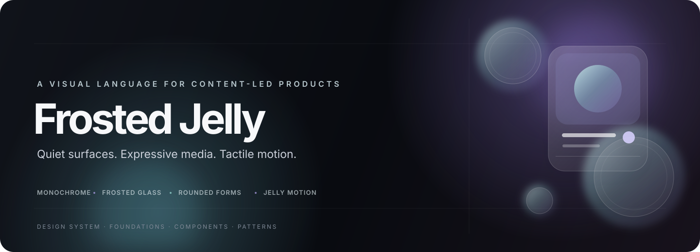

  

   

  
<strong>A calm foundation. A little atmosphere. A tactile finish.</strong>

  

    Frosted Jelly is a portable visual language for expressive, content-led products. 
    It pairs quiet monochrome surfaces with artwork color, frosted layers, rounded forms, and considered motion.
  

  

    <a href="https://github.com/aesw0x/arcmusic"><strong>Explore Arc Music ↗</strong></a>
    &nbsp;·&nbsp;
    <a href="#documentation">Documentation</a>
    &nbsp;·&nbsp;
    <a href="#principles">Principles</a>
  

 

## Overview

Frosted Jelly gives teams a coherent way to build interfaces that feel soft, focused, and alive. The system starts with a restrained neutral foundation, then lets meaningful media bring in color. Glass, shape, and motion add depth while keeping content clear.

**Arc Music** is an example app built with Frosted Jelly. Explore the app to see the system applied across playback, artwork-led pages, navigation, search, stats, and more.

> This repository is the design-system specification and pattern catalog. It is not currently a compiled UI component package.

## At a glance

| Foundation | Frosted Jelly approach |
| --- | --- |
| **Color** | Quiet monochrome surfaces; purposeful color from meaningful content |
| **Surfaces** | Frosted translucency with a tinted fallback when blur is unavailable |
| **Shape** | Rounded geometry with a clear hierarchy from capsules to large panels |
| **Motion** | Tactile feedback and fluid transitions that support the interaction |
| **Content** | Contrast, scrims, and adaptive color designed into each composition |

## Principles

### Keep the canvas quiet
Use neutral surfaces and controls to give important content room to lead.

### Let media set the mood
Draw accent color from artwork or other meaningful content, and protect the legibility of text and controls.

### Use depth with restraint
Frost, tint, blur, and subtle texture distinguish floating layers without obscuring what is underneath.

### Make touch feel considered
Use small, responsive feedback and smooth transitions. Motion should clarify cause and effect, not compete with content.

### Design for real conditions
Plan contrast, fallbacks, accessibility, and changing screen sizes as part of the composition.

## Documentation

| Guide | What you’ll find |
| --- | --- |
| [Foundations](Foundations/FOUNDATIONS.md) | Color, typography, shape, glass, artwork atmosphere, and interaction foundations |
| [Tokens](Tokens/TOKENS.md) | Reference values for palette, type, spacing, shape, effects, sizing, and motion |
| [Components](Components/COMPONENTS.md) | Reusable visual contracts and component-state guidance |
| [Patterns](Patterns/README.md) | Screen compositions, Now Playing, layouts, and scrim recipes |
| [Motion](Motion/MOTION.md) | Interaction choreography, timing, and motion guardrails |
| [Platform guidance](Platform/PLATFORM.md) | Rendering paths, blur fallbacks, and implementation boundaries |
| [Accessibility](Accessibility/ACCESSIBILITY.md) | Interaction targets, semantics, readable content, reduced motion, and verification |
| [Responsive layouts](Responsive/RESPONSIVE.md) | Guidance for adapting compositions to different app windows and form factors |
| [Arc Music example map](Reference/ARC_MUSIC_REFERENCE.md) | Screens and source locations where Frosted Jelly is used in Arc Music |

## See it in a product

### [Arc Music](https://github.com/aesw0x/arcmusic)

Arc Music is a music player built with Frosted Jelly. Browse the source and app screens to see the system in context—from frosted playback controls and artwork-led detail pages to custom motion and Now Playing.

## Using Frosted Jelly

Start with the [foundations](Foundations/FOUNDATIONS.md), then use the [tokens](Tokens/TOKENS.md), [component contracts](Components/COMPONENTS.md), and [patterns](Patterns/README.md) together. Treat the documented values as shared defaults; adapt them only when the product, platform, or accessibility needs call for it, and keep the visual relationships intact.

Frosted Jelly is implementation-agnostic. Arc Music demonstrates one Android implementation using Jetpack Compose and Material 3; other platforms can preserve the visual contracts with their native tools.

## License

No license file is currently included. Add a license before redistributing or reusing this work outside your own projects.

